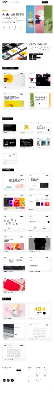

# Zero Design — Architecture, Interior & Spatial Experience Studio (33-Amaliy Ish)

Figma dizaynining yuqori aniqlikdagi (**Pixel-Perfect**) to'liq, zamonaviy, interaktiv va to'liq moslashuvchan (fully responsive) me'morchilik, interyer arxitekturasi va fazoviy brending platformasi: **Zero Design Studio (node-id: 2:2)**.

[-F24E1E?logo=figma&logoColor=white)](https://www.figma.com/file/B40CJceRjgB0PNo9F08ggO/Zero-Design?type=design&node-id=2%3A2&mode=design&t=kw21KWsKKlpaf1NT-1)
[](https://developer.mozilla.org/en-US/docs/Web/HTML)
[](https://developer.mozilla.org/en-US/docs/Web/CSS)
[](https://developer.mozilla.org/en-US/docs/Web/JavaScript)
[](https://developer.mozilla.org/en-US/docs/Learn/CSS/CSS_layout/Responsive_Design)
[](https://vercel.com/)

---

## 📸 Figma Dizayn Ko'rinishi (Master Canvas)



---

## 📌 Loyiha Haqida

Ushbu loyiha Figma platformasidagi **Zero Design (Zero Design Studio)** dizaynining to'liq ekotizimi va dizayn tokenlari (node-id: `2:2`, umumiy o'lchami: 1440 × 10434 px) asosida 100% aniqlik bilan ishlab chiqildi. Sayt xalqaro miqyosda e'tirof etilgan, kam uglerodli (low-carbon) me'morchilik, yapon Wabi-Sabi estetikasi, monumental beton va tabiiy travertin toshlaridan foydalanuvchi **Zero Design Studio**ning shaxsiy veb-platformasidir.

- **Figma Manzili**: [Zero Design — node-id: 2:2](https://www.figma.com/file/B40CJceRjgB0PNo9F08ggO/Zero-Design?type=design&node-id=2%3A2&mode=design&t=kw21KWsKKlpaf1NT-1)
- **Topshiriq**: 33-Amaliy Ish
- **GitHub Repozitoriyasi**: [https://github.com/soxibs48-eng/amaliy33](https://github.com/soxibs48-eng/amaliy33)

---

## ✨ Asosiy Sahifalar va Imkoniyatlar

Loyiha Figma dizaynidagi barcha asosiy bloklar va bo'limlarni hamda to'liq ko'p sahifali navigatsiyani qamrab olgan:

### 1. 🏠 Asosiy Bosh Sahifa (`index.html`):
- **Header & Navbar**:
  - Maxsus me'moriy geometrik monogramma logotipi (`0·DESIGN`).
  - Sahifalararo navigatsiya (Home, Projects, Services, Studio, Contact).
  - Tungi / Kunduzgi rejim (Dark/Light mode switch) `localStorage` xotirasi bilan.
  - Mobil qurilmalar uchun moslashuvchan interaktiv gamburger menyu (Mobile Drawer).
- **Hero Banner (Slice 1)**:
  - Yirik brend sarlavhasi: *"Crafting Timeless Spaces from Ground Zero"*.
  - Monolitik me'moriy pavilyon renderi va AIA Global Architecture Award suzuvchi medali.
  - Boshlang'ich ko'rsatkichlar: 120+ loyihalar, 18 ta xalqaro mukofot, 0% uglerod maqsadi.
  - *"Explore Selected Works"* va *"Studio Manifesto"* interaktiv tugmalari.
- **Marquee Ticker**:
  - Dinamik animatsiyali lenta: `ZERO FOOTPRINT • SUSTAINABLE MATERIALS • BIOPHILIC HARMONY • SPATIAL BRANDING`.
- **"01 // PHILOSOPHY" Bo'limi (Slice 2)**:
  - Bosh me'mor Kengo Sato manifesti.
  - 3 ta me'moriy ustun: Uglerod-manfiy materiallar, tabiiy soyalar poetikasi va yaxlit fazoviy oqim.
- **"02 // DISCIPLINES" Bo'limi (Slice 2-3)**:
  - 1. Me'moriy loyihalash va Bosh reja (Architectural Design & Master Planning).
  - 2. Premium interyer arxitekturasi va mualliflik mebellari (High-End Interior Architecture).
  - 3. Fazoviy brending va tajribaviy riteyl (Spatial Branding & Retail Pavilions).
  - 4. Raqamli egizaklar va real vaqt 3D vizualizatsiya (Digital Twins & 3D Spatial Renders).
- **"03 // PORTFOLIO" Bo'limi (Slice 3-5)**:
  - Dinamik toifalar filtri: `[ All ]`, `[ Architecture ]`, `[ Interior ]`, `[ Spatial & Retail ]`.
  - 6 ta master loyiha:
    1. **Villa Monolith (Kyoto, Japan)** — Bambukzor o'rmoni bilan uyg'unlashgan monolitik beton va kuygan kedr (Yakisugi) villasi.
    2. **The Travertine Sanctuary (Milan, Italy)** — Rim Navona travertini va satin bronzadan yasalgan lyuks pentxaus.
    3. **Zero Flagship Pavilion (Seoul, South Korea)** — Qizil gil va kinetik yorug'likdan bunyod etilgan riteyl ibodatxonasi (Red Dot 2025 g'olibi).
    4. **Lumina Nordic Retreat (Oslo, Norway)** — Fjord suvlari uzra osilgan nol-emissiyali geotermal shohona shole.
    5. **Atelier Vague (Paris, France)** — Fransuz gosmanning tarixiy binosidagi akustik eman arkali ijodiy studiya.
    6. **Kanso Oasis Villa (Tashkent, Uzbekistan)** — Markaziy Osiyo hovli mikroklimati va shisha kantileverlar uyg'unligi.
  - Har bir kartani bosganda **Interaktiv Modal Lightbox** ochilib, to'liq spetsifikatsiyalar, maydoni va materiallar tarkibini ko'rsatadi.
- **Teal Accent Banner (Figma ranglar uyg'unligi)**:
  - *"Ready to bring pure architectural harmony to your next vision?"* va to'g'ridan-to'g'ri maslahat olish tugmasi.
- **"04 // MATERIALITY" — Taktil Materiallar Laboratoriyasi (Slice 5-6)**:
  - Interaktiv material namunalari (Navona Roman Travertine, Shou Sugi Ban Wood, Living Brushed Brass, Bio-Composite Microcement, Reeded Acoustic Glass).
  - Tugmani bosganda tekstura, foto va texnik spetsifikatsiyalar jonli yangilanadi.
- **Metrics & Impact (Slice 4)**:
  - Skroll qilinganda avtomatik sanaluvchi hisoblagichlar: 15+ yillik tajriba, 120+ qurilgan ob'yekt, 18 ta global mukofot, 100% mamnunlik.
- **Client Testimonial (Slice 6-7)**:
  - Seul Han River Media Arts Center bosh ijrochisining rasmiy tavsifi.
- **"05 // INSIGHTS" — Studiya Jurnali (Slice 7)**:
  - Me'morchilikda soyalar fizikasi, nasha-beton (hempcrete) va hovli mikroiqlimi haqidagi ilmiy maqolalar.
- **"06 // CONNECT" — Konsultatsiya va Bog'lanish (Slice 7-8)**:
  - To'liq interaktiv konsultatsiya shakli: Ism, Email, Loyiha turi, Byudjet va Tavsif.
  - Xabar yuborilganda chiroyli **Toast bildirishnomasi** chiqadi.
  - Kioto, Milan va Toshkent studiyalarining aniq manzillari va telefon raqamlari.
- **Monumental Me'moriy Footer (Slice 8)**:
  - Yirik `ZERO DESIGN` relyefli suv belgisi, navigatsiya va ijtimoiy tarmoqlar havolalari.

---

### 2. 📖 Qo'shimcha Sahifalar:
- **`about.html`**: Zero Design Studiyasining 2011-yildan boshlangan tarixi, Kengo Sato manifesti, yetakchi hamkorlar jamoasi va xalqaro mukofotlar devori.
- **`projects.html`**: Barcha loyihalarning kengaytirilgan interaktiv arxivi, toifaviy filtrlash va modal oynalar.
- **`services.html`**: 4 ta yo'nalish bo'yicha to'liq xizmatlar ta'rifi va 4 bosqichli Zero metodologiyasi (Geodeziya -> Konseptual shakllantirish -> Tektonik detallar -> Nazorat va topshirish).
- **`contact.html`**: Yangi me'moriy buyurtmalar, byudjet darajalari va studiyalar bilan to'g'ridan-to'g'ri aloqa.
- **`404.html`**: Studiya stilistikasidagi minimalist xatolik sahifasi.

---

## 🛠 Texnologiyalar Steki

- **HTML5**: Semantik, qulay (WAI-ARIA) va qidiruv tizimlari (SEO) uchun optimallashgan markup.
- **CSS3**: Maxsus dizayn tokenlari, CSS Grid, Flexbox, Fluid Typography (`clamp`), CSS Variables (Light/Dark themes), nozik mikro-animatsiyalar.
- **Vanilla JavaScript (ES6+)**:
  - `initThemeToggle()` — Tungi va kunduzgi rejimni almashtirish va xotirada saqlash.
  - `initHeaderScroll()` — Skroll qilinganda silliq balandlik o'zgarishi va shaffoflik.
  - `initMobileDrawer()` — Mobil qurilmalarda yon menyu ochilishi va yopilishi.
  - `initPortfolioFilter()` — Loyihalarni toifalar bo'yicha silliq filtrlash.
  - `initProjectModal()` — Loyihaning to'liq chizma va spetsifikatsiyalarini ochuvchi Lightbox.
  - `initMaterialityExplorer()` — Materiallar laboratoriyasida tekstura va xususiyatlarni almashtirish.
  - `initCounters()` — Ekranga tushganda raqamlarni jonli hisoblash.
  - `initContactForm()` — Formalarni tekshirish va Toast bildirishnomasi chiqarish.
- **Vercel**: `vercel.json` orqali toza URL manzillari bilan global joylashtirishga tayyor.

---

## 📁 Loyiha Strukturasi

```text
amaliy33/
├── .gitignore
├── 404.html
├── about.html
├── contact.html
├── figma_preview.png
├── index.html
├── projects.html
├── README.md
├── services.html
├── vercel.json
├── assets/
│   ├── hero-arch.jpg
│   ├── journal-1.jpg
│   ├── journal-2.jpg
│   ├── journal-3.jpg
│   ├── logo.svg
│   ├── material-brass.jpg
│   ├── material-concrete.jpg
│   ├── material-glass.jpg
│   ├── material-travertine.jpg
│   ├── material-wood.jpg
│   ├── project-1.jpg
│   ├── project-2.jpg
│   ├── project-3.jpg
│   ├── project-4.jpg
│   ├── project-5.jpg
│   ├── project-6.jpg
│   ├── team-1.jpg
│   ├── team-2.jpg
│   ├── team-3.jpg
│   └── team-4.jpg
├── css/
│   └── styles.css
└── js/
    └── main.js
```

---

## 🚀 Mahalliylashtirish va Ishga Tushirish

1. Repozitoriyani yuklab oling:
   ```bash
   git clone https://github.com/soxibs48-eng/amaliy33.git
   cd amaliy33
   ```
2. Loyihani brauzerda oching:
   - `index.html` faylini istalgan brauzerda (Chrome, Edge, Safari, Firefox) ikki marta bosib oching yoki VS Code Live Server plagini orqali ishga tushiring.

---

## 👤 Muallif

- **Muallif**: Sirotillo Sobirjanov ([@soxibs48-eng](https://github.com/soxibs48-eng))
- **Guruh**: 21.10
- **Topshiriq**: 33-Amaliy Ish
- **Figma Manzili**: [Zero Design (node-id: 2:2)](https://www.figma.com/file/B40CJceRjgB0PNo9F08ggO/Zero-Design?type=design&node-id=2%3A2&mode=design&t=kw21KWsKKlpaf1NT-1)

